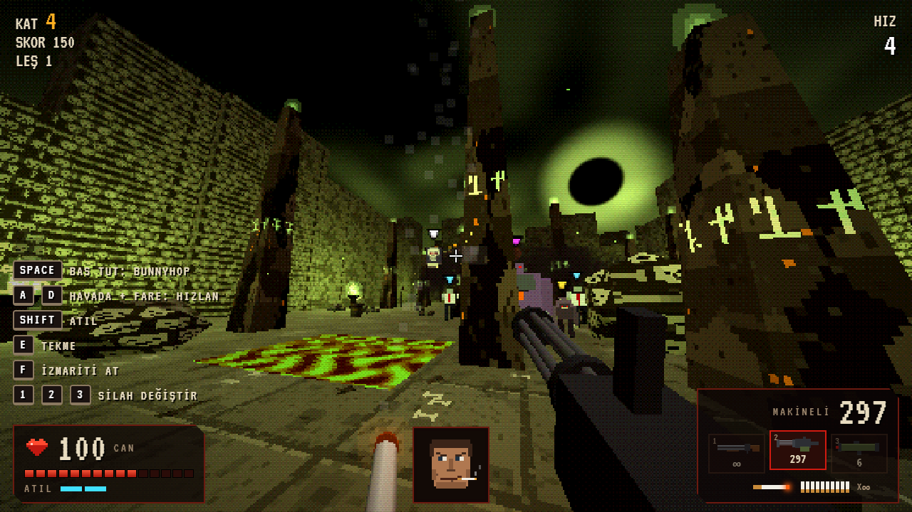
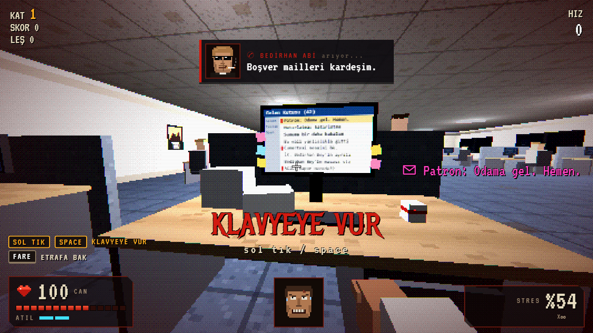
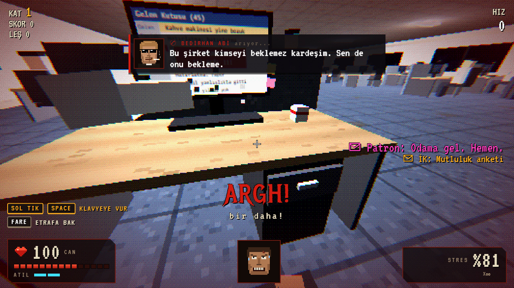
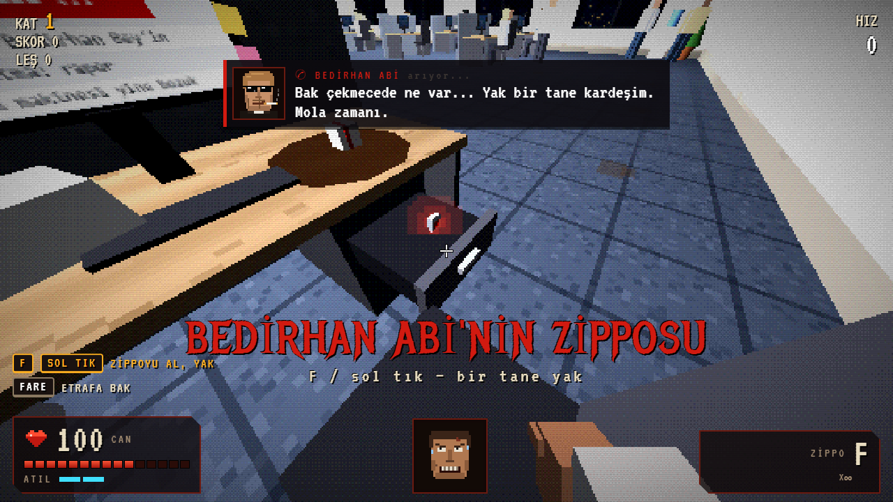
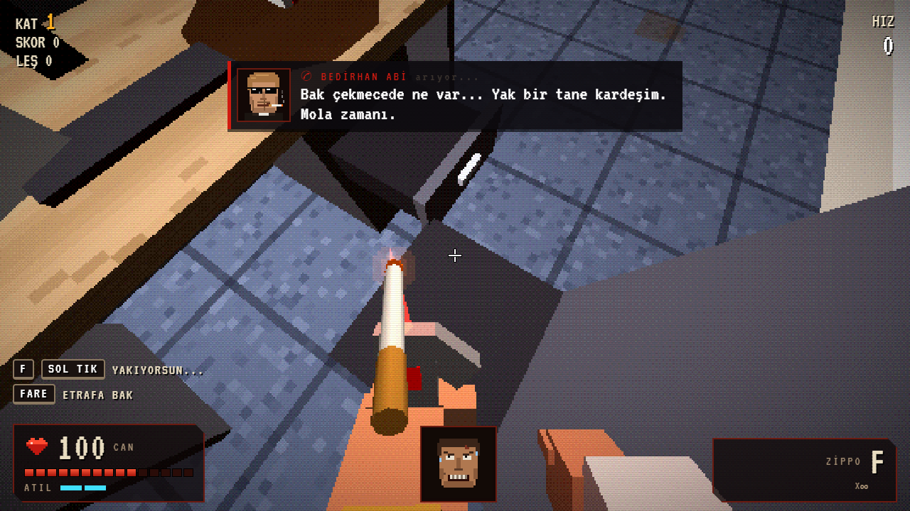
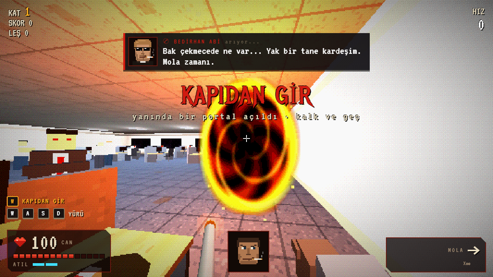
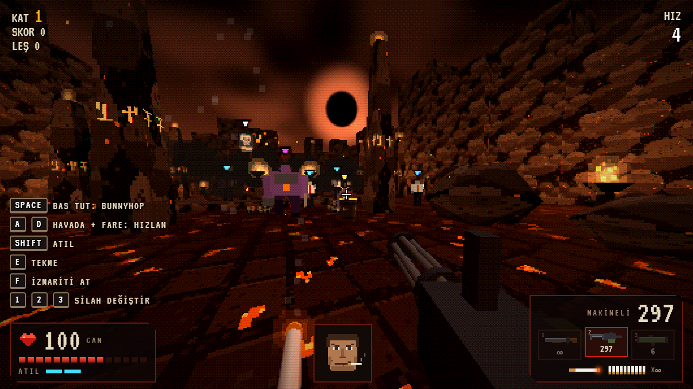
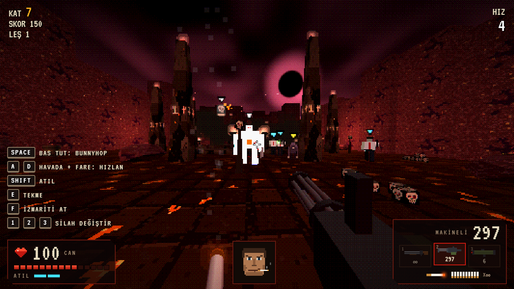

# SİGARA MOLASI

**Mesai bitmeden 5 dakikalık cehennem.**

Tarayıcıda oynanan, eski usul piksel grafikli, hızlı tempolu bir 3D FPS. Doom ruhu, Quake tarzı bunnyhop, bol kan ve bir ofis çalışanının en çok ihtiyaç duyduğu şey: bir mola.



> ⚠️ **Yasal uyarı:** Bu oyun tamamen kurgudur. Karakterler, şirket, mailler ve olaylar hayal ürünüdür; gerçek kişi, kurum ve kuruluşlarla hiçbir ilgisi yoktur. Oyun sigara ve tütün ürünlerini **özendirmez**. Sigara bağımlılık yapar ve öldürür. Oyundaki sigara yalnızca bir oyun mekaniğidir.
> Sigarayı bırakmak isteyenler için ücretsiz destek: **ALO 171 Sigara Bırakma Danışma Hattı**.

---

## Hikâye

Saat 17:59, günlerden pazartesi. Yeni masana yeni geçtin: geçen ay ortadan kaybolan **Bedirhan Abi'nin** masasına.

Mailler yağıyor: *"ACİL: Rapor nerede??"*, *"RE: RE: RE: FW: toplantı"*, *"Patron: Odama gel. Hemen."* Okunmamışlar 37'den tırmanıyor, kalbin hızlanıyor, görüşün daralıyor, patron arkanda kollarını kavuşturmuş seni izliyor.



Dayanamayıp klavyeye vuruyorsun. Bir kez. İki kez. Üçüncüde masanın çekmecesi fırlıyor. İçinde, üzerine pentagram kazınmış, kırmızı parlayan bir zippo var: Bedirhan Abi'nin zipposu.

| | |
|---|---|
|  |  |

Telefon çalıyor. Arayan Bedirhan Abi: *"Bak çekmecede ne var... Yak bir tane kardeşim. Mola zamanı."*

Ofiste sigara yasak, ama yakıyorsun. İlk nefeste masanın hemen yanında bir portal açılıyor. Ekranlar kızarıyor, iş arkadaşlarının gözleri kırmızı yanıyor ve hepsi dönüp sana bakıyor.

| | |
|---|---|
|  |  |

Portalın öbür tarafında kimse rapor istemiyor. Sadece şeytanlar var, ve elinde bir çifte.

---

## Cehennem

Sonsuz bir arena zinciri var: her arenaya girince kapı arkandan kilitleniyor, dalga dalga şeytan geliyor, hepsi ölünce çıkış açılıyor. Her üç katta bir cehennem değişiyor.

| Ateş | Kemik | Et |
|---|---|---|
|  |  |  |
| Bazalt, lav nehirleri, kara güneş | Kafatası duvarlar, dev kaburga kemerleri, yeşil ruh ateşi | Et duvarlar, kan gölleri, mor gökyüzü |

**Düşmanlar** (kafalarının üstündeki renkli işaretle ayırt edilir):

| | | |
|---|---|---|
| 🔵 **KÖLE** | Beyaz gömlekli, kravatlı, şeytanlaşmış eski iş arkadaşın | Uzaktan ateş eder |
| 🟡 **İT** | Hızlı, boynuzlu | Sıçrayarak saldırır |
| 🟣 **KASAP** | Dev, elinde satır | Yakın dövüş ve üçlü ateş topu |
| ⚪ **UÇAN KAFA** | Alevli kafatası | Üstüne hücum eder |

---

## Özellikler

- **Sigara mekaniği:** F ile Bedirhan Abi'nin zipposuyla sigara yakarsın; el animasyonu, alev, kor ve duman var. Yanarken can yavaşça dolar ve alınan hasar azalır. Düşmanlar varken yakarsan kısa bir **SOĞUKKANLI** ağır çekim başlar. Yanarken tekrar F'ye basarsan izmariti fırlatırsın: düşmanı ateşe verir, kükürt kazanını patlatır.
- **Bedirhan Abi:** güneş gözlüklü, ağzında sigarayla sürekli arar, gaz verir, teselli eder. Canın azalınca *"Yak bi tane kardeşim, can gelsin."*
- **Quake / CS tarzı hareket:** bunnyhop, havada sağa sola dönerek hızlanma, atılma (dash), roket zıplaması.
- **Üç silah:** sınırsız çifte, dönen namlulu makineli, roketatar. Silahların sert geri tepmesi var.
- **Gore:** düşmanlar paramparça olur, kan lekeleri yerde kalır.
- **Kombo ve stil puanları:** HAVADA, KAFADAN, KATLİAM, İZMARİT İNFAZI…
- **Tuş yönergeleri:** sol altta duruma göre değişen klavye ipuçları (KLAVYEYE VUR, ZİPPOYU AL, SİGARA YAK, İZMARİTİ AT…).
- **Retro görünüm:** düşük çözünürlüklü render, dithering ve kısıtlı renk paleti, Doom tarzı canlı surat portresi.
- **Hiç asset dosyası yok:** tüm dokular canvas ile, tüm sesler ve metal müzik Web Audio ile kod içinde üretiliyor.

---

## Kontroller

| Tuş | İşlev |
|---|---|
| WASD | Koş |
| Space (basılı) | Zıpla / bunnyhop |
| Havada A/D + fare | Hızlan (W'yi bırak, fareyi tuşla aynı yöne çevir) |
| Shift | Atıl (dash) |
| Sol tık | Ateş (ofiste: klavyeye vur / zippoyu al) |
| 1 2 3 / tekerlek / Q | Çifte · makineli · roketatar |
| E | Tekme |
| F | Sigara yak / yanarken izmariti fırlat (ofiste: zippoyu al) |
| M | Müzik aç/kapa |
| [ ] | Fare hassasiyeti |
| ESC | Duraklat ("TOPLANTIDA") |

---

## Çalıştırma

Kurulum gerektirmez. `index.html` dosyasına çift tıklaman yeterli. three.js ve fontlar CDN'den yüklendiği için internet bağlantısı gerekir.

İstersen yerel bir sunucuyla da açabilirsin:

```bash
npx serve .
```

## Teknik

- [three.js r128](https://threejs.org/) ile render, bundler veya build adımı yok.
- `js/world.js`: prosedürel arena üretimi, AABB çarpışma, ışın testi, ofis sahnesi
- `js/entities.js`: düşman yapay zekası, mermiler, patlamalar, parçacıklar, eşyalar
- `js/viewmodel.js`: birinci şahıs eller, silahlar, sigara ve zippo animasyonları
- `js/game.js`: oyuncu fiziği, silahlar, hikâye akışı, Bedirhan Abi, oyun döngüsü
- `js/hud.js`: arayüz, surat portresi, Bedirhan Abi araması
- `js/audio.js`: sentezlenmiş efektler ve prosedürel metal müzik
- `js/textures.js`: prosedürel piksel dokular

---

*Gerçek hayatta sigara molası yoktur, sadece sigara vardır. Bırakmak için: **ALO 171**.*
